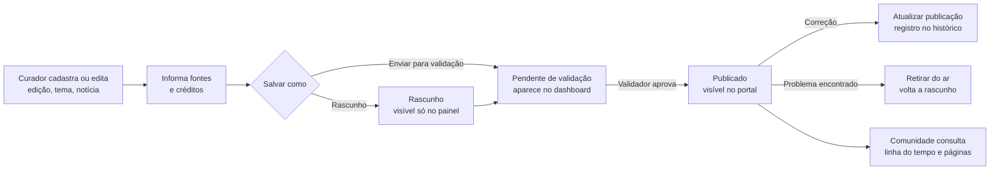

# 01 · Problema, atores e escopo do MVP

## Contexto

O Campeonato Joinvilense de Robótica (CJR) é uma iniciativa da Rede Municipal de Ensino de Joinville. A história começa antes da primeira edição:

| Ano | Marco |
|---|---|
| 2017 | A rede participa da FIRST LEGO League Challenge; chegam os primeiros kits Lego Mindstorms EV3 e são criados os clubes de robótica |
| 2018–2020 | Estudantes representam a rede em competições regionais |
| 2021 | **1ª edição do CJR**: 28 estudantes, 7 equipes, tema "Cidades sustentáveis" |
| 2026 | **6ª edição**: 69 equipes, 35 escolas, 312 estudantes, 7 categorias, tema "Planeta em alerta" |

_Fonte: Apresentação CJR 2026 (slides 2–4 e 13) e briefing do Desafio 03._

## Problema priorizado

> **A memória do campeonato está dispersa e não tem um ponto público de consulta confiável.**

- Existem matérias publicadas e um acervo interno da Secretaria, mas nada que reúna **edições, temas, categorias, vencedores e projetos** de forma contínua.
- Cada edição nova aumenta a dispersão: 6 edições, 7 categorias e centenas de equipes.
- Sem registro da **fonte**, não dá para saber qual número é o oficial. O briefing fala em "mais de 250 estudantes" em 2026; a apresentação registra 312.
- Sem um processo de **validação**, publicar resultados e imagens de estudantes (menores de idade) é arriscado.

### Por que este problema e não outros

Entre os aspectos listados no briefing (acervo, vencedores, critérios editoriais, consulta pública), priorizamos **acervo estruturado com procedência e validação**, porque:

1. Sem um acervo confiável, as outras funções (vencedores, divulgação) não se sustentam.
2. É o ponto que **não depende dos outros dois desafios**: edições e resultados podem entrar manualmente hoje e por integração amanhã.
3. Responde diretamente às perguntas do discovery: *qual é a fonte oficial?*, *o que pode ser publicado?*, *como corrigir preservando a procedência?*

## Atores

| Ator | Necessidade | Como o sistema atende |
|---|---|---|
| **Comunidade** (famílias, estudantes, imprensa) | Consultar a história, os temas e as categorias | Portal público, linha do tempo e páginas ligadas |
| **Escolas e professores** | Entender categorias e editais para participar | Categorias, Editais e "Faça parte" |
| **Curador / editor** (Secretaria de Educação) | Registrar edições, notícias e resultados | Painel `/admin` e editor em blocos |
| **Validador** (coordenação do CJR) | Garantir que só sai conteúdo correto e autorizado | Status "Pendente de validação" e confirmação de publicação |
| **Gestão operacional** (Desafio 01) | Fonte das edições (datas, local, inscrições) | Integração futura; ver [03](03-interoperabilidade.md) |
| **Domínio competitivo** (Desafio 02) | Fonte dos resultados e classificações | Integração futura; ver [03](03-interoperabilidade.md) |

## Escopo do MVP

**Dentro**
- Portal público com home, linha do tempo, edições, temas, categorias, notícias, editais e "Faça parte"
- Painel de curadoria com CRUD de 7 coleções
- Fluxo editorial Rascunho → Pendente → Publicado, com histórico
- Fonte e créditos obrigatórios na interface de cada registro
- Acervo real das 6 edições (a partir dos slides) e exemplos fictícios identificados

**Fora (consciente)**
- Inscrições, agenda e logística do evento → **Desafio 01**
- Pontuação, súmulas e classificação → **Desafio 02**
- Autenticação real e banco de dados compartilhado → backlog
- Integração funcional entre equipes (não exigida durante o evento)

## Fluxo principal

## Indicadores de sucesso (propostos)

- 100% das 6 edições com tema, categorias, números e fonte publicados
- 0 conteúdo publicado sem fonte
- Tempo para publicar os resultados de uma nova edição: menos de 1 dia após a validação
