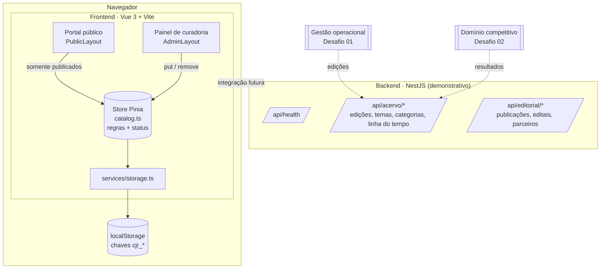
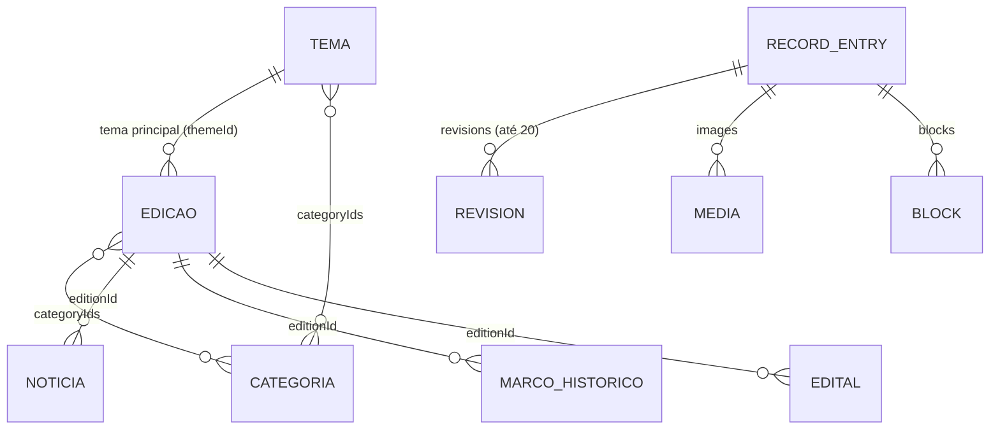

# 02 · Arquitetura e modelo de dados

## Visão geral

## Decisões técnicas

| Decisão | Motivo | Consequência |
|---|---|---|
| **SPA em Vue 3 + TypeScript** | Equipe já domina; tipagem forte no modelo de dados | `vue-tsc` checa os tipos no build |
| **Persistência em `localStorage`** | MVP demonstrável sem servidor e sem dados reais | Dados ficam por navegador; a camada `storage.ts` isola a troca por API |
| **Uma store central (`catalog.ts`)** | Regras de negócio e status num só lugar | O portal e o painel nunca divergem nas regras |
| **Portal lê só `status === 'published'`** | Garante que nada não validado vaze | `catalog.published(colecao)` é a única porta do público |
| **Acervo real separado dos exemplos** | `archive.ts` (fontes reais) × `seed.ts` (fictício, `demo: true`) | Exemplos aparecem com selo "Demonstração" |
| **Migração versionada do acervo** | Flags `acervo_slides_2026` e `exemplos_portal_2030` | Atualiza o acervo sem apagar o que o curador editou |
| **Backend NestJS descritivo** | Define desde já o contrato e os módulos (`acervo`, `editorial`) | Pronto para virar a API real sem reescrever o frontend |
| **Imagens redimensionadas no cliente** | Cabem no `localStorage` (máx. 1200 px, WebP) | Uploads de até 10 MB viram cerca de 300 KB |

## Módulos do frontend

| Pasta | Responsabilidade |
|---|---|
| `layouts/` | `PublicLayout` (header, skip-link, footer) e `AdminLayout` (sessão simulada e menu lateral) |
| `views/` | `Home`, `PublicCollection`, `PublicDetail`, `Participate`, `Dashboard`, `AdminList`, `Editor` |
| `components/` | `Timeline`, `EntryContent` (página de detalhe), `EntryFields` (formulário por coleção), `BlockRenderer`/`BlockSettings` (editor em blocos), `MediaEditor`, `Gallery` |
| `stores/catalog.ts` | Carga e migração, `published()`, `put()` com validações e histórico, `remove()` com checagem de vínculos, sincronização entre abas |
| `services/` | `archive.ts` (acervo com fontes), `seed.ts` (exemplos), `content.ts` (fábricas, `slugify`, `safeLink`/`safeImage`), `images.ts`, `storage.ts` |
| `types/content.ts` | Coleções, status, tipos de bloco e entidade `RecordEntry` |

## Rotas

| Rota | Tela |
|---|---|
| `/` | Home |
| `/edicoes`, `/temas`, `/categorias`, `/noticias`, `/editais` | Coleção pública |
| `/<colecao>/:slug` | Detalhe (edição usa o ano como slug: `/edicoes/2026`) |
| `/faca-parte` | Orientações para escolas e parceiros |
| `/admin` | Dashboard (exige sessão simulada) |
| `/admin/:section` | Lista da coleção |
| `/admin/:section/:id` · `/admin/:section/novo` | Editor |
| `/admin/nova-publicacao` | Assistente de nova notícia ou tema |

## Modelo de dados

Todas as coleções usam a mesma entidade-base `RecordEntry`; o formulário mostra só os campos relevantes para cada uma.

### `RecordEntry` (campos principais)

| Grupo | Campos | Observação |
|---|---|---|
| Identidade | `id`, `slug`, `title`, `subtitle`, `description` | `slug` gerado do título; em edições, é o ano |
| Tempo e lugar | `year`, `date`, `period`, `place` | Ano único por edição |
| Números | `teams`, `schools`, `students` | Agregados, nunca nominais |
| Conteúdo | `objective`, `context`, `features`, `results`, `blocks[]` | `results` = projetos e resultados validados |
| Vínculos | `themeId`, `editionId`, `categoryIds[]` | Exclusão bloqueada se houver vínculo |
| Procedência | `sources`, `credits`, `demo` | Exibidos em "Fontes e créditos" e no selo "Demonstração" |
| Mídia | `images[]` (`src`, `alt`, `caption`), `coverId`, `url` | `alt` é editável; `url` passa por `safeLink` |
| Editorial | `status`, `createdAt`, `updatedAt`, `revisions[]` | `status ∈ {draft, pending, published}` |

### Status

| Valor | Rótulo | Visível no portal |
|---|---|---|
| `draft` | Rascunho | Não |
| `pending` | Pendente de validação | Não (contado no dashboard) |
| `published` | Publicado | Sim |

### Regras aplicadas em `catalog.put()`

- Título obrigatório
- Edição: ano válido (1900–9999) e único; para publicar, precisa de tema
- Edital: para publicar, precisa de URL válida
- Conflito: se `updatedAt` mudou em outra aba, o salvamento é recusado
- Cada salvamento acrescenta `{ date, status }` ao histórico (mantém os 20 últimos)

## API demonstrativa (backend)

Prefixo `/api`, porta `3000` (variável `PORT`), escuta em `127.0.0.1`.

| Método | Endpoint | Retorno atual |
|---|---|---|
| GET | `/api/health` | `{ "status": "ok", "demonstracao": true }` |
| GET | `/api/acervo/edicoes` · `temas` · `categorias` · `linha-do-tempo` | Descrição da entidade e dos campos |
| GET | `/api/editorial/publicacoes` · `editais` · `parceiros` | Descrição da entidade e dos campos |

Hoje os endpoints documentam o contrato. O passo seguinte do backlog é implementar CRUD com banco de dados e trocar `storage.ts` por chamadas HTTP.
