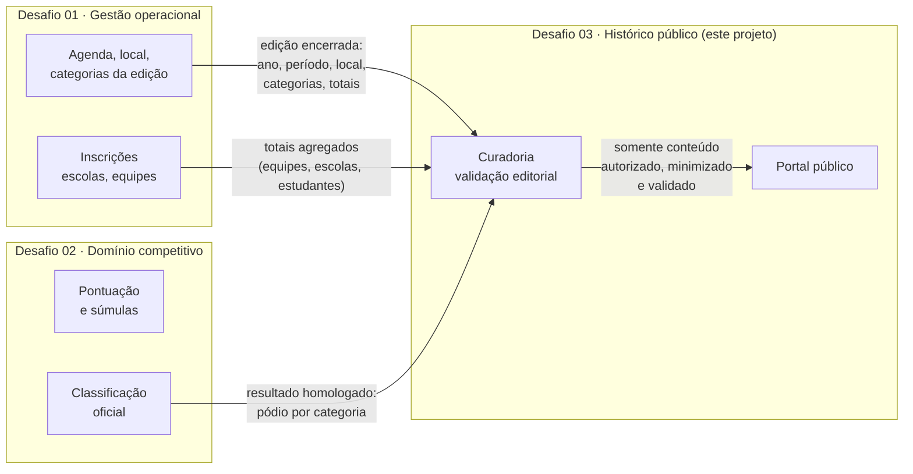

# 03 · Interoperabilidade, dados compartilhados e responsabilidades

O Desafio 03 é um dos **três domínios do mesmo ecossistema** do Campeonato Joinvilense de Robótica. Não exigimos integração funcional durante o hackathon, mas o sistema foi desenhado para recebê-la.

## Fronteiras



## Quem é dono de cada dado

| Dado | Dono (fonte oficial) | Papel do Histórico Público |
|---|---|---|
| Edição: ano, data, local, categorias ofertadas | **Gestão operacional** | Recebe ao final da edição e complementa com tema, textos e imagens |
| Totais de equipes, escolas e estudantes | **Gestão operacional** | Recebe **apenas números agregados** |
| Resultados e classificação | **Domínio competitivo** | Recebe o resultado **homologado**; nunca recalcula |
| Tema, textos, notícias, marcos históricos | **Histórico Público** | Cria, valida e publica |
| Fontes, créditos e autorização de imagem | **Histórico Público** | Registra e exibe |
| Decisão de publicar | **Histórico Público** (validador) | Nada é publicado automaticamente |

**Regra de ouro:** o Histórico Público **não corrige** dados de outro domínio. Se encontrar um erro num resultado, devolve à origem. Depois da correção lá, o dado é reimportado e passa de novo pela validação.

## Contratos propostos (integração futura)

Os dados importados entram como **Rascunho**, com `sources` preenchido automaticamente (ex.: `"Domínio competitivo · resultado homologado em 20/09/2026"`).

### Edição encerrada (Gestão operacional → Histórico)

```json
{
  "edicaoId": "cjr-2026",
  "ano": 2026,
  "periodo": "19 de setembro de 2026",
  "local": "Expocentro Edmundo Doubrawa, Joinville (SC)",
  "categorias": ["robotica-lego", "atto-micro-bit", "seguidor-de-linha"],
  "totais": { "equipes": 69, "escolas": 35, "estudantes": 312 },
  "encerradaEm": "2026-09-19T18:00:00-03:00"
}
```

### Resultado homologado (Domínio competitivo → Histórico)

```json
{
  "edicaoId": "cjr-2026",
  "categoria": "seguidor-de-linha",
  "homologadoEm": "2026-09-20T10:00:00-03:00",
  "podio": [
    { "posicao": 1, "equipe": "Equipe Exemplo A", "escola": "EM Exemplo 1" },
    { "posicao": 2, "equipe": "Equipe Exemplo B", "escola": "EM Exemplo 2" },
    { "posicao": 3, "equipe": "Equipe Exemplo C", "escola": "EM Exemplo 3" }
  ]
}
```

> Os contratos não carregam **nome de estudante**. O nível mínimo de identificação é equipe + escola.

## Como o MVP já se prepara para isso

| Ponto de extensão | Onde está |
|---|---|
| Camada de persistência isolada | `frontend/src/services/storage.ts`: troca de `localStorage` por HTTP |
| Módulos de API separados por domínio | `backend/src/main.ts`: `AcervoModule` (dados recebidos) e `EditorialModule` (dados próprios) |
| Campo de procedência em toda entidade | `RecordEntry.sources` |
| Entrada passa por validação | Status `pending` antes de `published` |
| Chave natural de edição | Ano único (`slug` = ano), fácil de casar com o `edicaoId` externo |

## Dependências e riscos

| Dependência | Risco | Mitigação |
|---|---|---|
| Resultado homologado do Desafio 02 | Atraso ou correção depois da publicação | Publicar com data de homologação; correções geram nova revisão |
| Totais do Desafio 01 | Divergência entre fontes (250+ × 312) | Sempre exibir a fonte; o curador escolhe a oficial |
| Autorização de imagem (Secretaria/escolas) | Publicar rosto de menor sem termo | Usar só imagens ilustrativas ou autorizadas; ver [04](04-editorial-privacidade.md) |
