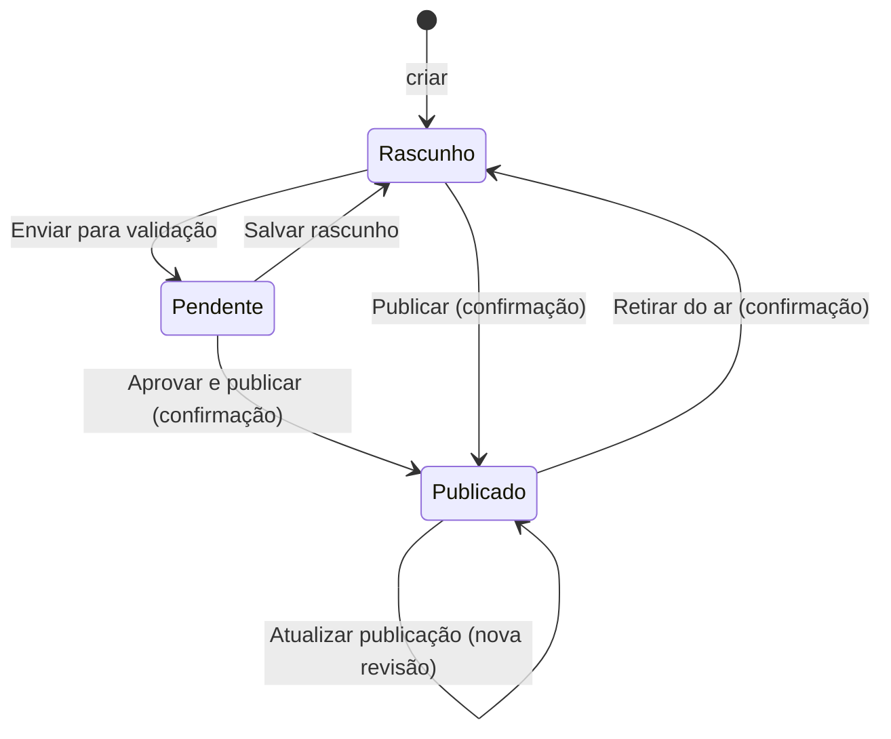

# 04 · Fluxo editorial, privacidade, segurança e acessibilidade

## Critérios editoriais

Antes de **Aprovar e publicar**, o validador confere:

| # | Critério | Como verificar no sistema |
|---|---|---|
| 1 | **Fonte informada** e rastreável | Campo "Fontes e referências" preenchido (ex.: "Apresentação CJR 2026 · slide 13") |
| 2 | **Dado confere com a fonte oficial** | Edições e totais: gestão operacional; resultados: domínio competitivo |
| 3 | **Sem dados pessoais de menores** | Nada de nome, foto identificável, turma ou contato de estudante |
| 4 | **Imagem autorizada ou ilustrativa** | Legenda indica a origem ("Imagem ilustrativa gerada por IA", "Apresentação CJR, slide 16") |
| 5 | **Texto alternativo** em toda imagem | Campo "Texto alternativo" no editor de mídia |
| 6 | **Conteúdo fictício identificado** | Opção "Identificar como demonstração" marcada |

## Ciclo de vida do conteúdo

- **Só `Publicado` aparece no portal.** O dashboard mostra quantas publicações aguardam validação.
- **Toda transição gera uma revisão** (data e status), visível em "Histórico de alterações".
- **Retirar do ar** é a forma recomendada de tirar um conteúdo do portal sem perder o registro.

## Correções preservando a procedência

Responde à pergunta do discovery *"Como corrigir conteúdo já publicado e preservar sua procedência?"*:

1. O curador abre o registro publicado e corrige.
2. Atualiza o campo **Fontes** com a nova referência (ex.: "Corrigido conforme ofício nº X, de 12/11/2026").
3. Clica em **Atualizar publicação**; o histórico registra a data.
4. Se a correção vier de outro domínio (ex.: resultado), o dado é corrigido **na origem** e reimportado.

> **Limitação atual:** o histórico guarda data e status, mas não o conteúdo anterior nem o motivo. O backlog prevê versões completas e um campo "motivo da alteração".

## Privacidade (LGPD)

| Princípio | Aplicação no projeto |
|---|---|
| **Minimização** | Só números agregados (equipes, escolas, estudantes) e, no futuro, equipe + escola nos resultados |
| **Dados fictícios no desenvolvimento** | Toda a base de exemplo é fictícia ou vem de material institucional público; o conteúdo fictício leva o selo "Demonstração" |
| **Menores de idade** | Nomes e imagens reais de estudantes só com autorização institucional e fundamento jurídico (regulamento, item 9) |
| **Finalidade** | Preservação da memória e divulgação educacional |
| **Transparência** | Fonte e créditos visíveis em toda página |

## Segurança

| Medida | Onde |
|---|---|
| Links aceitos só se forem caminho relativo ou `http(s)://` | `safeLink()` em `services/content.ts` |
| Imagens aceitas só se forem `data:image` (JPEG, PNG ou WebP) válido ou link seguro | `safeImage()` |
| Nenhum HTML vindo do usuário é interpretado (sem `v-html`) | Todos os componentes |
| Upload limitado (JPG/PNG/WebP, até 10 MB, redimensionado) | `services/images.ts` |
| Conflito de edição entre abas detectado | `catalog.put()` compara `updatedAt` |
| Exclusão bloqueada quando há vínculos | `catalog.remove()` |
| **Autenticação: simulada** | `AdminLayout`. Produção exige login real e perfis (editor × validador) |

## Acessibilidade

- `lang="pt-BR"` e `meta description`
- Link "Pular para o conteúdo" no portal
- Foco visível (`:focus-visible`) em todos os elementos interativos
- `aria-label` em botões só com ícone; `aria-expanded` e `aria-controls` no menu móvel; `aria-pressed` em botões de alternância
- Mensagens com `role="status"` (sucesso) e `role="alert"` (erro)
- Texto alternativo editável em todas as imagens
- `prefers-reduced-motion` respeitado
- Estrutura semântica: `header`, `nav`, `main`, `article`, `figure`/`figcaption`, `dl` para fatos e `ol` na linha do tempo
